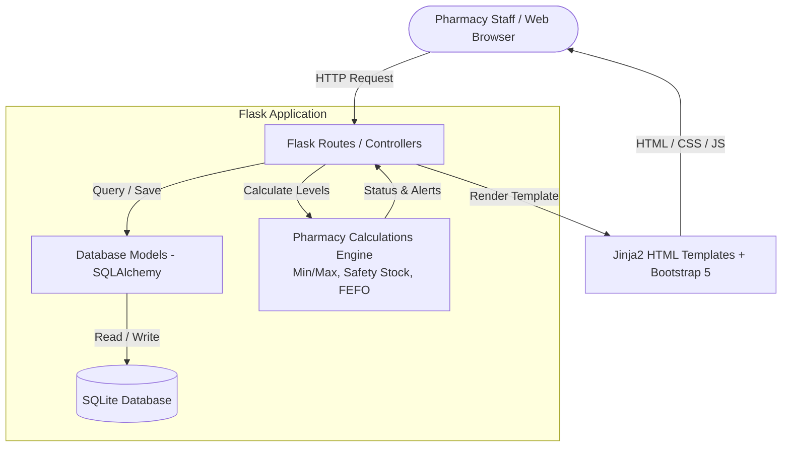

# PharmaStock 💊
### Pharmaceutical Inventory Management System (PIMS)

[](https://www.python.org/)
[](https://flask.palletsprojects.com/)
[](https://www.sqlite.org/)
[](https://getbootstrap.com/)
[](https://opensource.org/licenses/MIT)

> **PharmaStock** is an inventory management web application developed from a **clinical pharmacy perspective**. It bridges pharmacy inventory control theory—such as the **First-Expired, First-Out (FEFO)** rule, **Average Daily Consumption (ADC)**, and **Safety Stock (Buffer Stock)**—with clean, beginner-friendly software engineering.

---

## 📌 Table of Contents
1. [The Clinical Problem](#-the-clinical-problem)
2. [Pharmaceutical Inventory Control Theory](#-pharmaceutical-inventory-control-theory)
3. [Key Features](#-key-features)
4. [System Architecture](#-system-architecture)
5. [Tech Stack](#-tech-stack)
6. [Project Structure](#-project-structure)
7. [Installation & Setup](#-installation--setup)
8. [Running Automated Tests](#-running-automated-tests)
9. [Pre-configured Clinical Demo Data](#-pre-configured-clinical-demo-data)
10. [License](#-license)

---

## 🏥 The Clinical Problem

In pharmacy operations (hospital, community, or distribution), inventory control directly impacts patient care and regulatory compliance:
* **Medication Stockouts:** Running out of critical medications (e.g., insulin, antibiotics, antihypertensives) interrupts treatment courses and endangers patients.
* **Drug Expiration Wastage:** Poor batch tracking leads to medications expiring on the shelf, causing substantial financial losses and disposal burdens.
* **Lack of Safety Buffer Awareness:** Reordering based on intuition rather than lead time and consumption rate results in erratic supply chains.

**PharmaStock** replaces guesswork with automated, formula-driven thresholds and FEFO batch allocation.

---

## 📐 Pharmaceutical Inventory Control Theory

PharmaStock implements standard scientific inventory management formulas:

### 1. Safety Stock ($SS$)
Buffer stock maintained to protect against unexpected supplier delays or sudden demand surges (e.g., disease outbreaks):
$$\text{Safety Stock} = \lceil \text{ADC} \times \text{Buffer Days} \rceil$$
*Where $\text{ADC}$ is Average Daily Consumption.*

### 2. Minimum Stock Level / Reorder Point ($ROP$)
The inventory level that triggers a purchase order. When stock declines to this level, reordering immediately ensures new stock arrives just as the safety stock is reached:
$$\text{Min Stock (ROP)} = \lceil (\text{ADC} \times \text{Lead Time}) + \text{Safety Stock} \rceil$$

### 3. Maximum Stock Level ($Max$)
The storage ceiling designed to prevent capital lockup and mitigate the risk of stock expiring before dispensing:
$$\text{Max Stock} = \lceil \text{Min Stock} + (\text{ADC} \times \text{Review Cycle Days}) \rceil$$

### 4. FEFO (First-Expired, First-Out) Protocol
Unlike commercial retail which uses FIFO (First-In, First-Out), pharmaceutical standards mandate **FEFO**: batches with the nearest expiration date must always be dispensed first, regardless of which batch was received first.

---

## ✨ Key Features

* **Clinical Dashboard:** Real-time visibility into active medicine items, usable inventory valuation, low-stock warnings, and expiring batches.
* **Smart FEFO Dispensing:** Dynamically identifies and highlights the earliest-expiring batch during prescription dispensing.
* **Expiry Horizon Status Tags:**
  * 🔴 `EXPIRED`: Passed expiration date (quarantine required).
  * 🟠 `CRITICAL`: Expires within 30 days.
  * 🟡 `WARNING`: Expires within 90 days.
  * 🟢 `GOOD`: Safe shelf life (> 90 days).
* **Automated Stock Health Indicators:** Classifies stock levels as `OUT_OF_STOCK`, `CRITICAL_LOW`, `LOW_STOCK / REORDER`, `NORMAL`, or `OVERSTOCKED`.
* **Stock In / Restocking:** Intake deliveries by creating a new manufacturing batch or replenishing an existing batch.
* **Regulatory Movement Audit Log:** Complete audit trail tracking every dispense, delivery, and manual count adjustment.
* **Therapeutic Categorization:** Classify drugs by class (Antibiotics, Analgesics, Cardiovascular, Antidiabetic, etc.).

---

## 🏛️ System Architecture

PharmaStock uses the **Model-View-Controller (MVC)** architectural pattern:



---

## 🛠️ Tech Stack

* **Backend:** Python 3, Flask 3.0
* **Database & ORM:** SQLite 3, Flask-SQLAlchemy 3.1
* **Frontend:** Jinja2 Templates, Bootstrap 5, Bootstrap Icons
* **Testing:** Pytest

---

## 📂 Project Structure

```text
pharmastock/
├── app.py                      # Application entry point & route controllers
├── config.py                   # Configuration settings (Database URI, Secret Keys)
├── models.py                   # SQLAlchemy models (Category, Medicine, Batch, StockTransaction)
├── seed.py                     # Realistic pharmaceutical test data seeder
├── requirements.txt            # Project dependencies
├── .gitignore                  # Git ignore rules
├── .env.example                # Example environment configuration
├── LICENSE                     # MIT Open Source License
├── services/
│   └── inventory_logic.py      # Pure pharmacy calculation formulas (SS, ROP, FEFO, Expiry)
├── static/
│   └── css/custom.css          # Healthcare UI styling
├── templates/
│   ├── base.html               # Base layout, navbar, and flash alerts
│   ├── dashboard.html          # Clinical KPIs, urgent alert cards, and movement summaries
│   ├── inventory.html          # Inventory list with live filters and status badges
│   ├── medicine_detail.html    # Drug monograph, math cards, and FEFO batch list
│   ├── medicine_form.html      # Drug profile registration form
│   ├── batch_form.html         # Batch registration form
│   ├── dispense.html           # FEFO prescription dispensing interface
│   ├── restock.html            # Shipment receiving interface
│   ├── transactions.html       # Regulatory movement audit log
│   └── categories.html         # Therapeutic category management
└── tests/
    └── test_inventory_logic.py # Automated unit tests for calculation accuracy
```

---

## 🚀 Installation & Setup

### 1. Clone the Repository
```bash
git clone https://github.com/putrifathialiffia05-source/pharmastock.git
cd pharmastock
```

### 2. Create and Activate Virtual Environment
* On **macOS / Linux**:
  ```bash
  python3 -m venv venv
  source venv/bin/activate
  ```
* On **Windows**:
  ```bash
  python -m venv venv
  venv\Scripts\activate
  ```

### 3. Install Dependencies
```bash
pip install -r requirements.txt
```

### 4. Initialize & Populate Sample Pharmacy Data
```bash
python seed.py
```

### 5. Launch Application
```bash
python app.py
```
Open your browser and navigate to:
```
http://127.0.0.1:5000
```

---

## 🧪 Running Automated Tests

Run the test suite to mathematically verify that all inventory thresholds, buffer stocks, and FEFO sort rules produce expected results:
```bash
pytest
```

---

## 💊 Pre-configured Clinical Demo Data

The included database seeder (`python seed.py`) loads realistic medicines to demonstrate every inventory scenario:
1. **Panadol Extra (Paracetamol + Caffeine):** High-turnover analgesic with multiple active batches.
2. **Amoxil (Amoxicillin 500mg):** Antibiotic with a batch expiring in under 30 days (`CRITICAL ALERT`).
3. **Glucophage (Metformin HCl 500mg):** Chronic diabetes medication currently below its Reorder Point (`LOW STOCK ALERT`).
4. **Norvasc (Amlodipine 10mg):** Cardiovascular drug containing an expired batch flagged for quarantine (`EXPIRED ALERT`).
5. **Ventolin Syrup (Salbutamol 2mg/5ml):** Respiratory preparation with a batch expiring within 60 days (`WARNING ALERT`).
6. **Zyrtec (Cetirizine HCl 10mg):** Antihistamine with stock exceeding storage ceiling (`OVERSTOCKED`).

---

## 📄 License

This project is licensed under the [MIT License](LICENSE).
